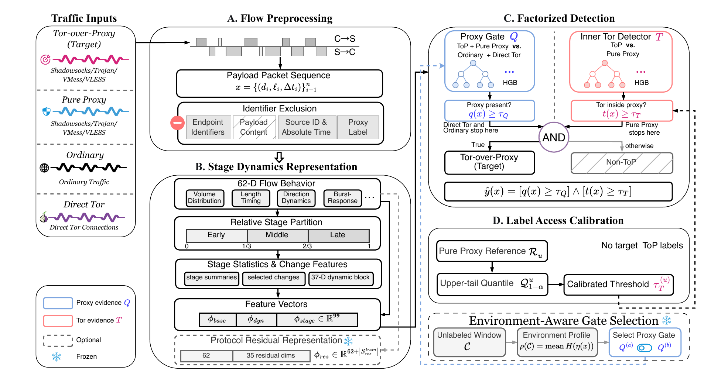

# NESTTOR: Detecting Tor-over-Proxy Traffic with Factorized Decisions

[中文](README_zh.md)

NestTor detects whether an encrypted proxy flow carries Tor without using addresses, ports, domains, filenames, absolute timestamps, payload content, or high-cardinality identifiers. The supported outer proxies are Shadowsocks, Trojan, VMess, and VLESS.



This repository is for research use only.

## Method

Tor-over-Proxy requires two conditions: an outer proxy must be present, and Tor must be present inside that proxy. NestTor models them separately:

- the proxy gate \(Q\) tests for outer-proxy evidence;
- the inner Tor detector \(T\) tests for Tor evidence inside a proxy;
- the final prediction is the hard conjunction of the two threshold decisions.

Each bidirectional TCP flow is represented by packet direction, payload length, relative inter-packet timing, burst behavior, and changes across early, middle, and late stages. The primary stage-dynamics representation combines 62 flow-behavior dimensions with 37 stage-dynamics dimensions. The proxy gate and inner detector are independently trained HGB models; they do not share parameters, an encoder, or a joint loss.

The protocol-residual representation is an alternative input for the inner detector and is not fused with the primary representation. For an unseen proxy, label-access calibration may adjust only the inner threshold using a disjoint Pure Proxy reference set. It does not access ToP labels, retrain the model, or construct traffic pairs.

## Repository contents

```text
data/
  manifest.csv
  past_features.csv
  sequences.npz
  dataset_metadata.json
code/
  common.py
  build_pilot_dataset.py
  run_pilot.py
  protocol_residual.py
  run_protocol_residual_audit.py
  run_residual_hgb_probe.py
  compare_role_separated_systems.py
main_framework.png
```

The public code contains the current core data builder, representation code, protocol-residual audit, role-separated HGB pipeline, and system comparison entry point. Historical experiments, revision records, raw PCAPs, and model checkpoints are not included.

## Installation

Python 3.10 or newer is recommended.

```bash
python3 -m venv .venv
source .venv/bin/activate
python3 -m pip install -r requirements.txt
```

Building samples from PCAP files also requires `tshark`.

## Running the core pipeline

A full reproduction requires the fixed 5,000-flow development dataset described by the paper. Its directory must contain `manifest.csv`, `past_features.csv`, `sequences.npz`, and `dataset_metadata.json`.

```bash
python3 code/run_protocol_residual_audit.py \
  --data-dir /path/to/development-data \
  --output-dir /path/to/residual-audit

python3 code/run_residual_hgb_probe.py \
  --data-dir /path/to/development-data \
  --output-dir /path/to/nesttor-output
```

Both experiment entry points refuse to overwrite an existing output directory. The public `data/` directory is a 650-flow processed compatibility sample for format inspection. It is not the development or confirmatory dataset and does not contain Pure Proxy negatives, so it must not be used to reproduce the headline results.

To verify the source files without running an experiment:

```bash
python3 -m py_compile code/*.py
```

## Data

The current manuscript reports a NestTor Benchmark containing 349,891 unique bidirectional TCP flows, 77,826 PCAP files, and 1,663 verifiable domains across the four proxy protocols. Domain- and capture-level groups are kept disjoint by the experimental manifests.

Raw PCAPs are not distributed in this repository. Researchers who need access may contact `tovey_zhou@foxmail.com`.

See [data/README.md](data/README.md) for the public sample schema.

## Results and scope

The current manuscript reports 99.45% macro-F1 on its held-out confirmatory evaluation. In the native end-to-end comparison under the same data permissions and splits, NestTor leads the next-best reproduced method by 11.99 percentage points.

These results do not imply uniform robustness. The manuscript separately evaluates unseen proxies, capture changes, and packet-level transformations, and reports sensitivity under distribution shift. Claims should therefore remain tied to the stated manifests, label-access rules, and evaluation conditions.

## Citation

Please cite the NestTor paper if this repository supports your research. Formal bibliographic information will be added after publication.

## License

License information will be added when the public release is finalized.
